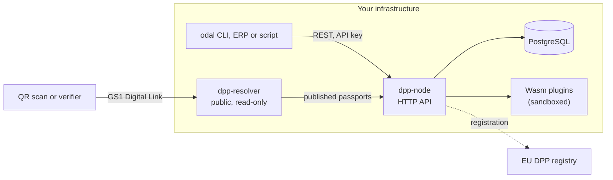

# Odal Node

Self-hosted software for issuing, signing and serving EU Digital Product Passports
(DPPs), written in Rust.

`dpp-core` is an open-source Rust library under Apache-2.0: stateless, with no
database and no network I/O. `dpp-engine` is the self-hostable node built on it,
under the Business Source License 1.1. Running it in production for your own
organisation's products and compliance obligations is free. Offering it to third
parties as a hosted service, or embedding it in a competing product, needs a
commercial licence.

> [!NOTE]
> **Status: pre-production.** CI runs the full passport lifecycle against
> PostgreSQL on every change, but no operator runs a node against real product
> data yet. APIs and schemas still change between minor versions.

## Repositories

| Repository | Licence | What it is |
|---|---|---|
| [**dpp-core**](https://github.com/odal-node/dpp-core) | Apache-2.0 | Rust crates on [crates.io](https://crates.io/crates/dpp-domain): the passport data model, versioned JSON Schemas per product group, regulatory validation rules, Ed25519/JWS signing, W3C Verifiable Credentials, GS1 Digital Link parsing, Asset Administration Shell export, and EU registry types. |
| [**dpp-engine**](https://github.com/odal-node/dpp-engine) | BSL-1.1 | The node: an Axum HTTP API over PostgreSQL, `did:web` signing identity, a public GS1 Digital Link resolver, a wasmtime sandbox for product group plugins, CSV/XLSX bulk import, and the `odal` CLI. |
| [**dpp-web**](https://github.com/odal-node/dpp-web) | Apache-2.0 | The sites: [odal-node.io](https://odal-node.io) and [docs.odal-node.io](https://docs.odal-node.io). |

## How the pieces fit

Both binaries compile `dpp-core` in. A passport is signed with your key, and anyone
can verify it against your public `did:web` document without contacting Odal.

## Why self-host

- **Your data stays with you.** Product, supplier and bill-of-materials data is
  stored in your own PostgreSQL. Odal never receives it. What leaves your network is
  what you configure or the law requires: the public passport view, the EU registry
  submission, and the independent back-up copy.
- **No lock-in.** The data model, schemas and validation rules are Apache-2.0.
  Passports are signed with your key and verify without any Odal service.
- **One node per company.** One database, one signing key, nothing shared with
  another operator.

## Get started

- **Use the library:** `cargo add dpp-domain`, then the
  [dpp-core quick start](https://github.com/odal-node/dpp-core#quick-start).
- **Run a node:** the [dpp-engine quick start](https://github.com/odal-node/dpp-engine#quick-start)
  takes you from `git clone` to a published, resolvable passport.
- **Read the docs:** [docs.odal-node.io](https://docs.odal-node.io), including the
  [API reference](https://docs.odal-node.io/api/).

Managed operation (a node run for you, still one node per company) is under
consideration and not offered. It is listed on the
[roadmap](https://odal-node.io/roadmap/) with everything else that is planned or
being built.

## Questions and contributions

Ask in Discussions on [dpp-core](https://github.com/odal-node/dpp-core/discussions) or
[dpp-engine](https://github.com/odal-node/dpp-engine/discussions); public answers help
the next person too. [SUPPORT.md](https://github.com/odal-node/.github/blob/main/SUPPORT.md)
lists where each kind of question goes, and
[CONTRIBUTING.md](https://github.com/odal-node/.github/blob/main/CONTRIBUTING.md)
covers commits and pull requests.

The most useful report is a place where the software disagrees with EU law, with
the text you read it against.

## Security

Report vulnerabilities privately to **security@odal-node.io** or through the
repository's **Report a vulnerability** button, never in a public issue. Policy:
[SECURITY.md](https://github.com/odal-node/.github/blob/main/SECURITY.md).

## Credits

`dpp-engine` verifies EU Trusted List signatures with
[xml-sec](https://github.com/structured-world/xml-sec), a pure-Rust implementation
of XMLDSig, XMLEnc and C14N by [@polaz](https://github.com/polaz) at
[Structured World](https://github.com/structured-world), published under Apache-2.0.
